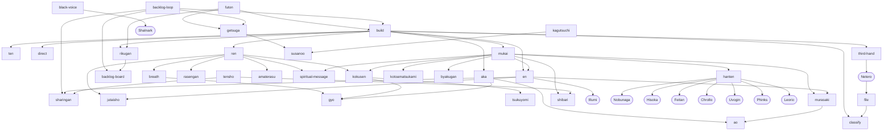

# Hatsu

**Repository-centric agentic delivery, run from your own terminal on your own credentials, first-party on
four agent surfaces: Claude Code, Codex, Cursor and Antigravity.**

One lead persona, **Kurapika**, who names which of six work-modes he is holding before he acts; a roster of
focused independents who review, measure, watch and file but never decide; and **fifty skills** that take a
request, an issue, a backlog, a pull request or a release from where it is to the human gate where you
decide. **Every deterministic step that has a verb is a verb** of the [**Nen**](https://github.com/zheref/nen)
CLI: Nen detects, computes, formats and verifies; a skill supplies only the judgment a binary cannot.

> **Nothing here merges `main`** except `getsuga` merging its own release-proposal PR inside its stated
> bounds. **Nothing here casts a review vote.** **Nothing here publishes a release on its own authority**:
> publication runs only on your typed go at **G3**. No GitHub App, no bot identity. The current release is
> whatever [`.claude-plugin/plugin.json`](.claude-plugin/plugin.json)'s `version` says; this page names no
> number on purpose.

---

## 🧭 Start here

| If you want to… | Read |
|---|---|
| **Install Hatsu on your surface and run a first request** | [`docs/using/`](docs/using/README.md) → [Claude Code](docs/using/claude-code.md) · [Codex](docs/using/codex.md) · [Cursor](docs/using/cursor.md) · [Antigravity](docs/using/antigravity.md) |
| Know which **workflow** to start, with what prompt, after which prerequisites | [Workflows](#-workflows), below |
| Know **which model and surface** a piece of work will be routed to | [`docs/DIRECT-MATRIX.md`](docs/DIRECT-MATRIX.md), and [Models and surfaces](#-models-and-surfaces) below |
| Tune a repository: **every configuration file, key by key** | [`docs/config/`](docs/config/README.md) |
| Understand **the loop**, the two configuration files, and the phases only a human calls | [`docs/WORKFLOW.md`](docs/WORKFLOW.md) |
| Meet **the roster** and read the maintainer's rulings | [`docs/ROSTER.md`](docs/ROSTER.md) · [`claude/agents/`](claude/agents/) |
| Read a skill's full contract | [`claude/skills/<name>/SKILL.md`](claude/skills/) · the longer index at [`claude/skills/README.md`](claude/skills/README.md) |
| Understand the **Nen dependency**: the pin, the range, the bootstrap, the halt | [`docs/NEN-CONTRACT.md`](docs/NEN-CONTRACT.md) |
| Make a repository a **consumer** | `hatsu:tenkai`, and [`docs/WORKFLOW.md` § *Consumer adoption*](docs/WORKFLOW.md#consumer-adoption--how-another-repository-becomes-a-hatsu-consumer) |
| Change something **in this repository** | [`CONTRIBUTING.md`](CONTRIBUTING.md) |
| See what each release changed | [`CHANGELOG.md`](CHANGELOG.md) · the README's former release notes in [`docs/history/release-highlights.md`](docs/history/release-highlights.md) |

---

## ⚡ Quickstart

One checkout serves every surface. Full recipes, caveats and uninstall steps are in each surface's guide.

| | **Claude Code** | **Codex** | **Cursor** | **Antigravity** |
|---|---|---|---|---|
| **install** | `scripts/hatsu_surface_link.sh --surface claude-code --root <checkout>` | `scripts/hatsu_surface_link.sh --surface codex --root <checkout>` | `scripts/surface_bootstrap.sh --surface cursor --target <repo> --bootstrap` | `scripts/hatsu_surface_link.sh --surface antigravity --root <checkout>` |
| **open a session** | `/kurapika <request>` | `$hatsu:ten` | `/ten` | `/ten` |
| **a request** | the next message, or `/hatsu:ren <request>` | `$hatsu:ren <request>` | `/ren <request>` | `/ren <request>` |
| **push, when you decide** | `/hatsu:aka` | `$hatsu:aka` | `/aka` | `/aka` |
| **review, tests, coverage, one PR** | `/hatsu:mukai` | `$hatsu:mukai` | `/mukai` | `/mukai` |
| **update Hatsu** | `/hatsu:bakuryuha` | `$hatsu:bakuryuha` | `/bakuryuha` | `/bakuryuha` |
| **guide** | [claude-code.md](docs/using/claude-code.md) | [codex.md](docs/using/codex.md) | [cursor.md](docs/using/cursor.md) | [antigravity.md](docs/using/antigravity.md) |

Three things are the same everywhere: [`nen`](https://github.com/zheref/nen) (installed and bound by the
warm-up), `git` + `gh` authenticated as you, and a [`nen/contract.json`](nen/contract.json) in the
repository you point Hatsu at, **the only thing Hatsu asks of your project**.

---

## 🗺️ How a request flows

```mermaid
flowchart LR
    you(["🧑 You"])
    subgraph loop["ren · every request, never pushes"]
      direction LR
      breath["breath<br/>prove the base"] --> rasengan["rasengan<br/>author"] --> kokusen["kokusen<br/>verify, commit"] --> amaterasu["amaterasu<br/>launch"] --> sm["spiritual-message<br/>report"] --> bell["jutaisho<br/>bell"]
    end
    subgraph pr["the PR side"]
      direction LR
      aka["aka<br/>lint · squash · catch up · push"] --> mukai["mukai<br/>review · tests · coverage · one PR"] --> en["en<br/>readiness watch"]
    end
    subgraph rel["the release side"]
      direction LR
      getsuga["getsuga<br/>release PR · tag · fan-out"] --> kagutsuchi["kagutsuchi<br/>non-production send"] --> mugetsu["mugetsu<br/>publish"]
    end
    you -->|"a request"| loop
    loop -->|"🧑 you call aka"| pr
    en -->|"🧑 G2 / G4 · you merge"| main[("main")]
    main -->|"🧑 you call getsuga"| rel
    kagutsuchi -->|"🧑 G3 · your typed go"| mugetsu
    mugetsu --> shipped(["Shipped"])
    en -.-> third["third-hand<br/>harvest · rikugan final state"]
```



**Five phases are yours to call, and no agent ever prompts for them**: `aka` (push), `mukai` (review and
PR), **the merge**, `kagutsuchi` (non-production upload) and `mugetsu` (publish, **G3**). Everything
between them runs on its own; only a genuine **G5** interrupts you: red required tests, touched-file
coverage under the ladder, a semantic merge conflict, an unsettled adversarial finding, a stuck-PR
escalation. A stop is `nen stop`'s banner, the report link, lettered options with a star on the
recommended one, and the question asked through your surface's own option picker.

---

## 🔁 Workflows

The common ways work starts, what each one needs before it can run, and what runs once it does.
**Spelling per surface**: Claude Code `/hatsu:<skill>` (and `/kurapika <request>` to open a session),
Codex `$hatsu:<skill>`, Cursor and Antigravity `/<skill>`; the tables show the bare skill and its
arguments. `<CODE>#<N>` is an issue or PR by its product code (`HA#12`), the codes declared in
[`nen/repos.json`](nen/repos.json).

### Deliver

| Workflow | Start it | Prerequisites | What runs |
|---|---|---|---|
| **Work a request in the loop** | `kurapika <request>` on Claude Code; elsewhere `ten`, then `ren <request>` | a repository with `nen/contract.json` and `nen/workflow.json`; `gh` authenticated; the request **on the invocation line** (`ren` refuses a turn with none) | `breath → rasengan → kokusen → amaterasu → spiritual-message → jutaisho`, in an isolated effort worktree, looping on every later message |
| **Publish the branch** | `aka` | a committed `ren` branch; nothing is pushed before this | `gyo → squash unpushed → ao → gyo again if moved → push` |
| **Review, test and open the PR** | `mukai` | a pushed branch; `review.scopes`, `tests`, `coverage` declared; `nen/gates.json` with a reviewer | `murasaki → hanten → kokusen → kotoamatsukami → byakugan → evidence → shibari → landing report → offer en` (or start it under `mukai.autoEn`) |
| **Drive a PR to Ready** | `en on <CODE>#<N>` · `sharingan <CODE>#<PR> to <G2\|G4>` | an open PR; `monitor.maxCycles` (the cap is grammar) | `sharingan → murasaki when behind → sharingan → observe CI and the current-head round → jutaisho at Ready`, then the merge prompt |
| **Deliver one issue end to end** | `build <CODE>#<N>` | the issue exists; its `lang/` and `job/` labels (classify runs if missing); your session's model, surface and effort inside `direct`'s picks, else one question | `ten → classify → direct → ren → aka → mukai → en → rikugan → third-hand` |
| **Turn a dirty working copy into a PR** | `tensho <target-branch\|main>` · `jujisho` to split by axis | uncommitted work; a target branch | review every file → commit → one PR (two stacked for `jujisho`) → `sharingan` to its gate |
| **Review the branch before any PR** | `hanten [for <scope>]` | `review.scopes` in `nen/workflow.json`; reviewer budget left for the effort | `nen review scopes` → one reviewer per raised scope → findings in one shape → fix or push back |
| **Validate a merged feature** | `black-voice [<CODE>#<PR>]` | a merged PR with acceptance criteria; `tests.uiValidation` tooling resolvable | **Shalnark** drives every criterion through ephemeral UI tests → pass / fail / not-testable as a Rikugan page |

### Operate the backlog

| Workflow | Start it | Prerequisites | What runs |
|---|---|---|---|
| **File an issue** | `file <problem> <repo>` · bare `file` for what the session just discussed | `nen/labels.json`; the backlog reconciled first | duplicate search → `classify` → one issue on your confirmation |
| **Classify, then route to a model** | `classify <CODE>#<N>[,…] \| backlog [<repo>]` · `direct <CODE>#<N> \| backlog` | the `lang/` and `job/` families declared (classify lands them by PR on a consumer first); `direct.publish` if you want labels written | two label axes → `nen direct resolve` → three picks on five axes; sweeps apply nothing before one confirmation |
| **Work a severity band or one label** | `futon <repo>@<severity[+] \| label> [then tag \| tag+fanout \| <skill> \| <prose>]` | `nen/colors.yml` severity values; labels synced | one `build` per issue, PRs with an actor behind them; the `then` step runs only once every PR is merged (the **advance go**) |
| **Drive the whole backlog to zero** | `backlog-loop` | a repository with product codes and a release lane | triage → `build` and `sharingan` across at most two efforts → `getsuga` at severity-batch boundaries → a board per cycle |
| **Consolidate a long backlog** | `backlog-synthesis <critical\|high\|medium\|low\|all> [<repo>]` | open issues sharing a clause, file or root cause | a plan artifact → on approval one consolidated issue, originals attached and closed |
| **See the state** | `backlog-state <repo\|all>@<gate>` · `backlog-board` · `pr-state <CODE>#<N>` · `rikugan [for …] [as final\|register]` | read access | read-only tables and Rikugan pages; readiness is `nen pr ready`'s verdict, quoted |
| **Inventory a consumer's own efforts** | `senkei <repo>` | a consumer repository | classify every effort, re-run a dead reviewer job, wake a stalled PR, state Ready or not per PR |
| **Repeat until a condition holds** | `izanami <task> until <cond>` (read-only) · `izanagi <task> until <cond> up to <N>` (acts) | for `izanagi`, the cap typed: no cap, no run | the task per iteration, under its own authority |
| **Harvest the sitting's friction** | `third-hand` | En completed, or you are wrapping up | **Netero** proposes 0 to 3 issues; only what you pick is filed |

### Ship, adopt, maintain

| Workflow | Start it | Prerequisites | What runs |
|---|---|---|---|
| **Cut a release tag** | `getsuga [<hash \| branch \| main \| last-commit \| checkout>]` | `release.unitPaths`; `changelog.d/` fragments; `nen release preflight` green | preconditions → `susanoo` → one release-proposal PR, merged by `getsuga` itself inside § 3a (else by you) → the post-merge tag → the CON-22 repin fan-out |
| **Package a checkout** | `susanoo [--lane <lane>]` | an `archive` row on the lane | `nen shu archive`, locally; uploads nothing |
| **Send a build to a non-production destination** | `kagutsuchi [<target>]` | a non-production `project.targets` entry, typed or `deploy.defaultTarget`; a clean tree | freshness gate → `susanoo` if the archive is not the tip's build → `nen shu deploy --target <name> --run` → the opt-in `dist/` tag |
| **Publish to production** (**G3**) | `mugetsu [<target>]`, **your typed go only** | the tag cut; `nen release preflight` green; a `release` row or a production target | `nen shu release` and/or `nen shu deploy --run`, one target per call |
| **Make a repository a consumer** | `tenkai [<path>] [--slug <owner/name>]` | a checkout of the target | diagnose → `nen scaffold init` routes → the readiness workflow, permission pack, mirrors, defaults, each as its own PR at the target's gate |
| **Keep a consumer's canon mirror current** | `limbo [for <path>] [to <tag>] [as check\|sync]` | `.claude/canon-values.yml`; the canon pin in `nen/repos.json` | `nen canon pin` → `nen canon mirror check` → regenerate on your answer → one PR → `en` |
| **Raise self-hosted runners** | `jusshin [for <owner/repo>] [pool <id>] [x <count>] [on <machine-code>]` | `nen/workflow.json` → `runners`; admin rights; a host per pool | `nen runner inventory → plan → script` (you consent once) → `verify` → preflight job → `enable` |
| **Pair a device as a launch target** | `jujutsu pair <device>` | the device on hand; its platform tools | on-device steps → the platform probe → the declaration lands by PR |
| **Swap a worktree into your core checkout** | `amenotejikara [list \| swap <name> [--take] \| return]` | `nen wc worktrees` | core's work parked in a pinned commit, the worktree's tree swapped in, and back |
| **Update Hatsu on this surface** | `bakuryuha [--channel auto\|trunk\|release] [--dry-run]` | a checkout you keep | make or confirm the first-party install → fast-forward → the new `ten` → read back → a **Next** block |
| **Author canon for every surface** | `great-hiker <request> [--effort low\|medium\|high]` · `great-hiker evolve [<surface>]` | a canon repository | write under `claude/` and `contracts/` → regenerate every mirror → check → one PR at G4; `evolve` files one Netero-shaped issue per drifted surface |

---

## 🧑‍🤝‍🧑 The roster

[`docs/ROSTER.md`](docs/ROSTER.md) is the authority on who exists and their standing;
[`claude/agents/`](claude/agents/) is the authority on what each one does. Commits carry the canonical
`Hatsu-Agent: <persona>` trailer and never model, surface or session attribution.

### Kurapika, the lead persona

The whole local plane in one identity. He names the mode in play before he acts, so you can catch him
holding the wrong authority *before* he uses it.

| Mode | Lane | Where its work stops |
|---|---|---|
| 💪 **Enhancer** | product code: edit, build and test locally, open the PR; `en` drives it to Ready | **the merge**, yours, at the prompt |
| 📜 **Conjurer** | canon and governance authoring: constitutions, handbooks, schemas, agent definitions, taxonomies, thresholds, each clause with its conditions | the policy gate, **yours** |
| ⚙️ **Transmuter** | machinery: Nen verbs and tests, hooks, workflows, generators, manifests, contract files; *improvised shell → deterministic verb* | the policy gate, **yours** |
| 🎛️ **Manipulator** | GitHub-side ops: drives, wakes, labels, retargets, thread stewardship | drives *to* a gate, crosses none |
| 📡 **Emitter** | release and fan-out: the tag cut, changelog collation, preflight, the repin fan-out | prepares a release; **never publishes one** |
| 🧪 **Specialist** | product intake: a raw thought elicited into a decision-complete brief | epic approval, **yours** |

### The independents

Each has one discipline Kurapika delegates to rather than absorbing. All are **advisory**: none edits
non-test source, votes, blocks or merges.

| | Agent | Discipline, in one line | Raised by | Standing |
|---|---|---|---|---|
| 🔍 | **[Nobunaga](claude/agents/nobunaga.md)** | code practices, scope completeness, adversarial reading; the default reviewer on every path, two reviews per effort | `hanten`, scope `code` | ratified |
| 🎨 | **[Hisoka](claude/agents/hisoka.md)** | UI/UX review and cheap objective measurement before a PR: contrast, target sizes, type scale, reduced motion, artifact delta; cites `UX-{n}` | `hanten`, scope `ui` | ratified |
| 🛡️ | **[Feitan](claude/agents/feitan.md)** | security and security only; deterministic scan rows first, then `SEC-{n}` by id, never from memory | `hanten`, scope `security` | ratified |
| 🏛️ | **[Chrollo](claude/agents/chrollo.md)** | architecture and handbook conformance: `UZF-{n}`, exactly one stack handbook, the repository's own notes; coverage-floor breaches route here | `hanten`, scope `architecture` | ratified |
| ⏱️ | **[Uvogin](claude/agents/uvogin.md)** | performance on the fixed seven metrics, each number with its method block and baseline | `hanten`, scope `performance`; beside Phinks before a cut | ratified |
| 💥 | **[Phinks](claude/agents/phinks.md)** | adversarial pre-release QA under the proven-finding discipline: a test failing 3/3 or a measured number, else nothing filed | `hanten`, scopes `release` and `surfaces` | ratified |
| 💰 | **[Leorio](claude/agents/leorio.md)** | economics, only when a change may move money; a charted report, for and against, `ECON-{n}`; a cost is never a finding | `hanten`, scope `economics` | ratified |
| 👁️ | **[Illumi](claude/agents/illumi.md)** | the long watch: `en`'s pre-Ready observation hold, read-only through `nen watch until`, on a stated command allowlist | `en`, step 5 | **provisioned**, for `en`'s watch only |
| 🤖 | **[Shalnark](claude/agents/shalnark.md)** | post-merge UI validation automator: ephemeral UI tests against the delivered acceptance criteria | `black-voice` only | activated from the bench |
| 🪑 | **[Netero](claude/agents/netero.md)** | chairman of process: watches the Hunters execute and files complete, labelled issues when canon or machinery need enhancement | `third-hand`; `great-hiker evolve` | ratified |
| 🎯 | **[Gon](claude/agents/gon.md)** | the mission-scoped trusted delegate: mission, gates, conditions, expiry, logging | no composite yet | ratified as an agent; **his delegation grammar is a DRAFT, so he crosses no gate** |

Killua and the rest of Illumi's row are **open** sub-decisions; Machi, Kortopi, Pakunoda and Shizuku sit
on the **bench** with no definition and may not be acted as. [`docs/ROSTER.md`](docs/ROSTER.md) carries both
tables and every ruling.

---

## 🧰 The skills

Fifty, invoked as `hatsu:<name>` in your surface's spelling, fifty-one directories with `ten`. Each row:
what the skill means, the steps it runs **as the skills it calls**, and who calls it. Full contracts live
in [`claude/skills/<name>/SKILL.md`](claude/skills/); the longer index is
[`claude/skills/README.md`](claude/skills/README.md).

### Session and host

| Skill | Meaning | Steps · calls | Called by |
|---|---|---|---|
| `ten` | the Nen contract, executing: probe `nen`, install the pin checksum-verified when absent or out of range, bind it on the host, check the mirrors, place this surface's copy | `nen shu tools` → bootstrap if needed → `scripts/nen_global.sh` → `surface_mirror_check.sh` → `surface_bootstrap.sh --install-all` | every composite's first step; you, once per session |
| `/kurapika` | the summon command on Claude Code: warm-up, the policy inbox, then the request as the first `ren` turn as Kurapika | `ten` → `nen warmup` → `ren` | you |
| `bakuryuha` | bring this surface's Hatsu to the newest version its channel offers and switch onto it, ending with what to type or open | `hatsu_surface_link.sh` → `hatsu_plugin_update.sh` → the **new** `ten` → read back → **Next** | you |

### The turn loop

| Skill | Meaning | Steps · calls | Called by |
|---|---|---|---|
| `ren` | **composite**: one request, one turn, in an isolated effort worktree; never pushes | `breath → rasengan → kokusen → amaterasu → spiritual-message → jutaisho` | you; `build` |
| `breath` | warm-up once per effort: fetch, fast-forward the base, cut `{model}/{persona}/{descriptor}`, prove the iteration checks on the fresh tip; a red base is G5 | `nen shu warmup` → `gyo` | `ren` |
| `rasengan` | author the change and its focused tests inside the request's scope; commits nothing, never lowers a bar | iteration checks, `gyo`, `tsukuyomi` as feedback | `ren` |
| `kokusen` | verify the finished tree, then commit locally: iteration checks and focused tests, staging triage with an ask on every flagged file, the formatted message | `gyo` → `tsukuyomi` → `nen stage triage` → `nen commit format` | `ren`; `mukai` |
| `gyo` | lint, the declared `lint` verb; never tests, never coverage | `nen shu lint` | `breath`, `rasengan`, `kokusen`, `aka` |
| `tsukuyomi` | the focused tests for the behaviour this turn changed; never the full suite, never a patched test | the declared scoped lane | `rasengan` (may), `kokusen` (must) |
| `amaterasu` | build and launch the declared target from your core checkout, never a worktree; hands back the exact command | `nen shu build` → `project.launch` | `ren`; you, to relaunch |
| `spiritual-message` | the rich turn or landing report: the desk above the fold, the last turn, landed / fought back / not delivered, the delta graph, evidence, spend | `nen report render --variant turn\|landing` | `ren`, `mukai`, `en`; you |
| `jutaisho` | the bell: the declared rungs (push, OS, sound), the `.nen/last-stop.json` marker, and the gate question through the surface's picker | `nen stop` | `ren`; `en` at Ready; you |
| `ao` | pull from the base: rebase if unpushed, merge if published; mechanical conflicts resolved, a semantic one is G5. Never pushes | `nen wc catch-up` | `aka`, `murasaki`, `en`; you |

### The PR side

| Skill | Meaning | Steps · calls | Called by |
|---|---|---|---|
| `aka` | **push, yours to call**: lint, squash the unpushed commits, catch up, lint again if the tree moved, push | `gyo → nen wc squash → ao → gyo → nen wc publish` | you |
| `mukai` | **composite, yours to call**: the whole PR side in a fixed order, ending with the offer of `en` (or starting it under `mukai.autoEn`) | `murasaki → hanten → kokusen → kotoamatsukami → byakugan → publish → evidence → shibari → spiritual-message as landing → offer en` | you |
| `murasaki` | **composite**: catch up a published branch, rerun the checks, return before pushing a source change so tests and coverage can refresh | `ao` → checks → push only if already published | `mukai`, `en` |
| `hanten` | adversarial review pre-PR: classify the change set by scope, raise one reviewer per raised scope with budget left, settle each finding | `nen review scopes` → Nobunaga · Hisoka · Feitan · Chrollo · Uvogin · Phinks · Leorio → fix or push back | `mukai`; you |
| `kotoamatsukami` | impacted project-wide unit, UI and integration tests; a skipped suite needs a named proof | `nen shu test` on the declared suites | `mukai` |
| `byakugan` | coverage capture and touched-file measurement against the ladder; raises the G5 under `coverage.minimum`; never runs tests | `nen shu coverage --touched` | `mukai` |
| `shibari` | compose the PR body from the template and open one PR: evidence table, checklist, associated issues, attribution ledger, changelog fragment | `nen pr body-check` → `nen pr open` → request reviewers | `mukai`; you |
| `en` | **composite**: one PR from open to verified Ready and your merge prompt, under a mandatory acting-cycle cap | landing report → `sharingan` → `murasaki` when behind → `sharingan` → observe (Illumi on a long hold) → `jutaisho` at Ready | `mukai`'s offer; `build`; you |
| `sharingan` | drive one PR to readiness at its gate and stop: first blocking condition, threads, the owed reviewer round, the verdict | `nen pr ready` → threads → `nen pr request-reviews` | `en` (steps 2 and 4); `tensho`; you |
| `pr-state` | one PR's readiness as the deterministic verdict, quoted, conjunct by conjunct. Read-only | `nen pr ready --explain` | you; `rikugan` |
| `third-hand` | the sitting's process friction harvested as Netero into 0 to 3 issues you pick; then the session ends | Netero → `file` per pick | `build`'s last step; you |
| `amenotejikara` | swap which worktree your core checkout holds, and swap back; never discards | `nen wc worktrees` → `nen wc swap` | you |
| `jujutsu` | pair a device and register it as a launch target through a PR | platform probe → declaration → PR at the gate | you |

### Issues, backlog and reports

| Skill | Meaning | Steps · calls | Called by |
|---|---|---|---|
| `file` | one well-formed, correctly labelled, non-duplicate issue | duplicate search → `classify` → `nen issue create` on your confirmation | you; `third-hand`; the discovery protocol |
| `classify` | the two label axes, `lang/<key>` and `job/<key>`, on an issue, a set, a backlog or an inline effort | `nen classify apply`; the families landed by PR on a consumer first | `file`; `build`; you |
| `direct` | which model should do the work and where: three picks (primary, fallback, recommended) on five axes, read live | `nen direct resolve` → compare with this session → publish only where `direct.publish` opts in | `build`, `ren`; you |
| `build` | **composite**: one issue to a delivery PR at its human gate | `ten → classify → direct → ren → aka → mukai → en → rikugan → third-hand` | you; `futon`; `backlog-loop` |
| `futon` | **composite**: one selector of the backlog to PRs with an actor behind them, then the typed `then` step once every PR is merged | `build` per issue → `getsuga` for `tag`/`tag+fanout`, or the named skill, or prose mapped to skills → `rikugan` | you |
| `backlog-loop` | **composite**: the backlog to zero in severity order | triage → `build` + `sharingan` (≤ 2 efforts) → `getsuga` at batch boundaries → `backlog-board` per cycle | you |
| `backlog-synthesis` | a long backlog reconciled into a short one, behind a plan you approve | plan artifact → `file` → sub-issues attached and closed | you |
| `backlog-state` | the backlog as one gate-oriented table. Read-only | `nen` reads → `nen/colors.yml` status | you |
| `backlog-board` | the same sweep as a Rikugan page. Read-only | `nen report render --variant register` | you; `backlog-loop`; `rikugan` |
| `rikugan` | the final state of a just-completed workflow as a Rikugan page: `final` for a delivered one-effort scope, `register` otherwise. Read-only | `backlog-board` § 3's render path; `nen pr ready` quoted per PR | `build`, `futon`, `backlog-loop`, `en`; you |
| `senkei` | a consumer repository's own efforts inventoried and driven; not read-only | classify → `nen run rerun-failed` → wake → readiness per PR | you |
| `black-voice` | post-merge UI validation, on your call only | resolve the PR and its issues → **Shalnark** once → Rikugan page | you |
| `izanagi` · `izanami` | repeat a task until a condition holds: acting under a mandatory cap, or read-only | the task per iteration | you; `en` (the cap is `izanagi`'s) |
| `tensho` · `jujisho` | a dirty working copy into one PR, or split into two stacked PRs by axis | review each file → commit → `shibari` → `sharingan` | you |

### Release, consumers and canon

| Skill | Meaning | Steps · calls | Called by |
|---|---|---|---|
| `susanoo` | the distributable the lane declares, built locally; names the tag `kagutsuchi` will cut, cuts none | `nen shu archive` | `getsuga`, `kagutsuchi`; you |
| `getsuga` | **composite**: the release tag, end to end, with its own folded release-proposal PR | preconditions → `susanoo` → release PR → `nen pr merge --release-unit` (§ 3a) → tag → CON-22 fan-out | you; `futon then tag`; `backlog-loop` |
| `kagutsuchi` | a build to a declared **non-production** destination, behind a freshness gate | `send_freshness_check.sh` → `susanoo` if stale → `nen shu deploy --run` → `dist/` tag | you; `futon then kagutsuchi` |
| `mugetsu` | **G3**: publish one release to one production destination, on your typed go only | `nen release preflight` → `nen shu release` / `deploy --run` | you; `futon then mugetsu` on the advance go |
| `tenkai` | make a repository a working consumer, deterministically and idempotently; diagnoses before it writes | `tenkai_adopt.sh diagnose → apply` → `config_values.sh fill` → PRs at the target's gate | you |
| `limbo` | a consumer's canon mirror kept current on every declared surface | `nen canon pin → mirror check → mirror generate` → one PR → `en` | you |
| `jusshin` | a consumer's self-hosted runners as boot-persistent services, proven by a preflight job before they are switched on | `nen runner inventory → plan → script → verify → workflow → preflight → enable` | you |
| `great-hiker` | canon prose and machinery authored once and landed on every surface with that surface's capabilities | author → `nen surface mirror generate` × 3 → check → PR at G4; `evolve` → Netero-shaped issues | you |
| `bankai-handbooks` · `bankai-quality` | resolvers: which handbooks and rule-id prefixes govern a repository, and which QA and performance tooling | read live from the canon checkout at the pinned tag | Chrollo, Feitan, Phinks, Uvogin, Shalnark |

<details>
<summary><b>Who calls whom</b>: the composition graph</summary>



</details>

---

## 🧠 Models and surfaces

**A tier is named, never a model version.** [`nen/workflow.json`](nen/workflow.json) → `models` maps four
tiers to one alias per surface, and a role to a tier; the live id is read from the surface when a skill
runs, never remembered. A subagent never runs on the frontier tier, which is where your own conversation
lives.

| Tier | Role | Claude Code | Codex | Cursor | Antigravity |
|---|---|---|---|---|---|
| `frontier` | `orchestrator`: your own session | `fable` | `astra` | `grok` | `ultra` |
| `deep` | `reviewer` | `opus` | `sol` | `grok` | `pro` |
| `fast` | `worker`, `measurer` | `sonnet` | `terra` | `composer` | `flash` |
| `economy` | `watcher`, `formatter` | `haiku` | `luna` | `composer` | `flash` |

**Which model should do a given piece of work, and on which surface?** `hatsu:direct` answers it
deterministically from an issue's `lang/` and `job/` labels through
[`contracts/direct.registry.json`](contracts/direct.registry.json): **three picks** per cell, the
**primary** (cost-aligned best), the **fallback** (on another provider or surface) and the **recommended**
(cost-agnostic), each on five axes: model line, tier, latest version, effort dial and surface, with the
restart line for a session that is not already there. **[`docs/DIRECT-MATRIX.md`](docs/DIRECT-MATRIX.md)
renders the whole matrix** from the same registry: every job in every domain, per language, with worked
examples, so you can read the answer without running the skill. `build` and `ren` run `direct` before
authoring; a session outside the set of picks is asked once and never blocked.

---

## 🚪 The gates

Hatsu drives work **to** a gate and stops there. Clause ids are the inherited constitution's;
[`docs/ROSTER.md`](docs/ROSTER.md) carries the same table with every ruling behind it.

| Gate | Clause | What it is | Delegable? |
|---|---|---|---|
| **G1** | `CON-4` | epic approval: you apply one delivery-mode label | **never** |
| **G1-M** | `CON-25` | release into build: the building stage label | **the one delegated crossing**, under four named carve-outs inside a logged run |
| **G2** | `CON-5` | merge to `main` | **never, save one PR**: every PR ends at `en`'s merge prompt; `getsuga` merges its own release proposal inside § 3a |
| **G3** | `CON-6` | release go/no-go: publishing | **never on an agent's word**: only your typed go, by name or as a `mugetsu` step of your own `futon` chain |
| **G4** | `CON-7` | policy or spec change: a PR into a **canon** repository, whose product is the process | **the same as G2** |
| **G5** | `CON-47` | anything else human-only: a semantic conflict, a new business rule, signing material, an on-device trust prompt, a supply-chain failure | **never**; its definition *is* "the decision is yours" |

> **G4 is the repository's role, not the file's kind.** A consumer declaring its own `nen/*.json`, a CI
> workflow or a `scripts/` entry configures how the system is set up *there*; it governs nothing else and
> stands at **G2**. No agent casts a `request_changes` review on any PR: it would be recorded as **your**
> vote on a PR you have not read.

---

## 📏 The Nen contract

- `nen` is a **hard, version-ranged, fail-closed** dependency with **auto-install**. Every deterministic
  step is one of its verbs; there is no improvised fallback for a Nen-owned operation, ever.
- [`nen/contract.json`](nen/contract.json) is the **single source of truth** for the pin: `dependency.minimum`
  (the range) and `dependency.pinned_ref` (the build the bootstrap installs) move independently.
- **The range is nen's verdict**, read off `nen shu tools`' `compat floor:` row, never this page's arithmetic.
- Absent → nen's own checksum-verified `bootstrap/nen.sh`, fetched to a file, never piped. Out of range →
  re-pinned **through the verb**. A checksum failure is never retried.
- The session **halts only when the bootstrap itself fails**, printing the exact command for you to run.
- The warm-up links the verified pin at `~/.local/bin/nen` so your terminal and the agent run the same build;
  `HATSU_NEN_GLOBAL=0` opts out.

The long form, the verdict table and the host binding: [`docs/NEN-CONTRACT.md`](docs/NEN-CONTRACT.md).

---

## 📚 What lives here

```
.claude-plugin/     plugin.json + marketplace.json: the manifest every surface installs from; `version` is the cache key
.codex-plugin/      the Codex plugin overlay pointing at the same skills and generated hooks
claude/             the one AUTHORED copy: skills/<name>/SKILL.md (50 + ten), agents/<persona>.md (12), commands/kurapika.md, rules/
surfaces/           GENERATED mirrors for codex/, cursor/, antigravity/: never edited by hand (docs/using/mirrors.md)
hooks/              the three harness hooks: session start (binds nen), stop bell, base-branch guard; POSIX sh, no jq
nen/                this repository's own declarations: contract.json, workflow.json, gates.json, labels.json, repos.json, colors.yml, decisions.json
contracts/          plugin-owned registries: permissions, the classify taxonomy, the direct registry, the config catalogue, scan rows
templates/          the PR body, the report pages (spiritual-message.html, rikugan.html), the readiness and preflight workflows, release-publish.sh
scripts/            the guards and runtime scripts an installed copy executes, each with its fixture
docs/               WORKFLOW · PROCESS · ROSTER · STANDALONE-ENTRY · GATE-CONFIGURATION · DIRECT-MATRIX · ECONOMICS · NEN-CONTRACT
docs/using/         setup, usage and maintenance per surface          docs/config/   every configuration file, key by key
docs/surfaces/      each surface's dated evolution record              docs/ab/       per-skill evidence of the port
CHANGELOG.md        what each release changed; changelog.d/ holds the fragments getsuga collates
```

**Evidence.** Every skill ships with its own record in [`docs/ab/`](docs/ab/): the mechanics before and
after the port and a live transcript reaching the same verdict with fewer improvised commands. Those
transcripts name private repositories by stable placeholders; the legend is
[`docs/PUBLIC-REDACTION.md`](docs/PUBLIC-REDACTION.md).

---

## 🤝 Contributing

This is a canon repository: every change lands by PR at **G4**, through Hatsu's own loop. A change to a
shipped surface needs a `version` bump, with no opt-out (a `no plugin bump: <reason>` line is honoured only
where no shipped path changed), commits carry
`Hatsu-Agent: <persona>` and nothing else of the kind, and the mirrors regenerate in the same commit as their
inputs. The rules, the guards and how to validate locally: [`CONTRIBUTING.md`](CONTRIBUTING.md).

## License

**MIT**, see [`LICENSE`](LICENSE).
