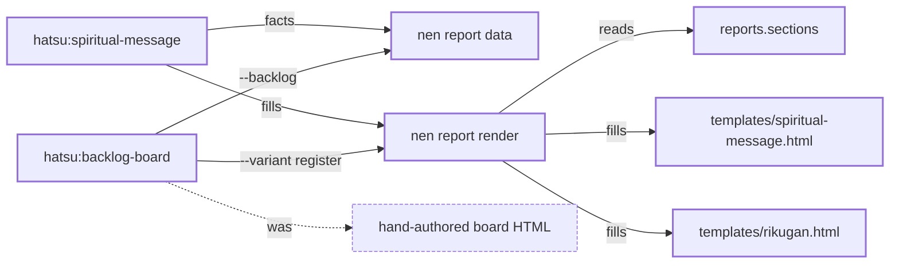

<!--
  spiritual-message.md -- the turn and landing report as Markdown, for a surface whose native report
  is a Markdown artifact (Antigravity). Filled by the same verb, from the SAME data document and the
  SAME reports.sections.<variant>.blocks as templates/spiritual-message.html: one document, two
  renders, so the two cannot disagree on which blocks a variant shows. Block for block it mirrors
  that file, in its order and under its headings; each block opens with a block-marker comment
  the report-markdown-guard lane reads. Structure, escaping and the checked examples:
  docs/PROCESS.md, The Markdown report. NOTHING IN THIS COMMENT SPELLS A SUBSTITUTION TAG.
-->
<!-- hatsu:block masthead -->
# Markdown report templates for Antigravity

landing · Hatsu · spiritual-message · landing

zheref/hatsu · against origin/main · 2026-10-13 11:00 CEST

stage in review · G4 — pending · worktree fmc-215 · branch fable/kurapika/ha-215-markdown-report-templates

<!-- hatsu:block tally -->

| need you | blockers | landed | gaps |
|---:|---:|---:|---:|
| 1 | 0 | 4 | 1 |

<!-- hatsu:block desk -->
## Your desk

<!-- hatsu:ask -->
**MERGE** · G4

### Merge HA-PR-#250 into main?

nen pr ready says ready &amp; every thread is settled

- **A** · Merge it ⭐ recommended\
  the templates ship in the next release
  <pre>gh pr merge 250 --repo zheref/hatsu --merge --match-head-commit 0123abc</pre>
- **B** · Ask for another round\
  the PR waits | a round is owed
  <pre>none</pre>
- **C** · Close it\
  the Antigravity reports stay hand-authored
  <pre>gh pr close 250 --repo zheref/hatsu</pre>

Objects: [HA-PR-#250](<https://github.com/zheref/hatsu/pull/250>) [HA-IS-#215](<https://github.com/zheref/hatsu/issues/215>)

> [!IMPORTANT]
> **G4 readiness, verbatim:** “ready”\
> ready: 6/6 checks green &amp; 0 unresolved threads &lt;head 0123abc&gt;


<!-- hatsu:block lastTurn -->
## This last turn

Render the Antigravity artifact from a template | not by hand

<details>
<summary>The request, in full</summary>

<pre>Add templates/spiritual-message.md &amp; templates/rikugan.md;
fill them with nen report render &lt;variant&gt;.</pre>

</details>

- landed · Two Markdown templates beside the HTML ones — one data document | two renders
- not delivered · A stdout render for the brain directory — --out must resolve inside --repo; the copy goes through &lt;reports.dir&gt;/current.md

### Corrections, check fallout and half-run stops

Corrections:

- Commands render in &lt;code&gt;, not a code span · asked by hanten · Hisoka · why: a span shows &amp;amp; literally · handled: fixed | both templates

Check fallout:

- prose-guard · found: rikugan 2 bytes from its ceiling · handled: trimmed § 4 &amp; § 5

Half-run stops:

- none this turn · autonomy: autonomous · policy: decisions.json | default


<!-- hatsu:block landed -->
## Landed, fought back, not delivered

The whole session against origin/main, not just this turn.

### Landed

- templates/spiritual-message.md &amp; templates/rikugan.md — the blocks, order and desk rules of the HTML | verbatim

### Fought back

- Escaped values inside code spans — GFM shows &amp;amp; literally there, so commands render in &lt;code&gt;

### Not delivered

- A render to stdout — a nen request | tracked separately


<!-- hatsu:block delta -->
## Architecture delta

The report path: one data document, two templates per report



<details>
<summary>The same delta as text — nodes and edges</summary>

Nodes:

- hatsu:spiritual-message · skill · changed
- hatsu:backlog-board · skill · changed
- nen report data · verb · changed
- nen report render · verb · changed
- reports.sections · config · added
- templates/spiritual-message.html · template · changed
- templates/rikugan.html · template · added
- hand-authored board HTML · residue · removed

Edges:

- spiritual-message → facts → report-data · unchanged
- spiritual-message → fills → report-render · changed
- backlog-board → --backlog → report-data · added
- backlog-board → --variant register → report-render · added
- report-render → reads → sections · added
- report-render → fills → tpl-spiritual-message · unchanged
- report-render → fills → tpl-sm · added
- backlog-board → was → handwritten · removed

</details>

<!-- hatsu:block evidence -->
## Evidence

### Tests

- passed · report-markdown-guard — every variant renders | blocks in order &amp; one star per ask

### Touched-file coverage

plugin · Reports/coverage.json · json-summary · 88% overall

| File | Lines | Band |
|---|---:|---|
| scripts/report_markdown_check.sh | 92% | ideal |
| templates/rikugan.md | 81% | minimum |


<!-- hatsu:block spend -->
## Spend

### Where the time went

| Phase | Share | Time | Steps |
|---|---:|---:|---|
| rasengan | 100% | 4 m 05 s | render 2.1 s · guard 9.8 s |
| kokusen | 37.5% | 1 m 32 s |  |

### Tokens by model

| Surface | Model | Input | Output | Cache read | Cache write | Minutes | Source |
|---|---|---:|---:|---:|---:|---:|---|
| claude-code | opus | 120400 | 18200 | 990000 | 41000 | 22 | /cost |
| antigravity | pro | not reported | | | | | |

Actions minutes: 6

Antigravity reports no token counts | recorded as not reported


<!-- hatsu:block launch -->
## How to launch

<pre>nen report render --variant turn --template &quot;$hatsu_root/templates/spiritual-message.md&quot; \
  --data &lt;doc&gt; --out Reports/current.md --repo . &amp;&amp; cat Reports/current.md</pre>

<!-- hatsu:block decisions -->
## Decisions already made

- Free text rides in lists, never table cells — a | in a value would split the cell


<!-- hatsu:block prBody -->
## The pull request body

<details>
<summary>As it was posted</summary>

<pre>## Why

Antigravity reports drift | the template fixes the structure &amp; order.

## How to verify

```bash
nen shu test --repo . --lane report-markdown-guard
```</pre>

</details>

---

landing · in review · G4 — pending · fmc-215 · fable/kurapika/ha-215-markdown-report-templates

zheref/hatsu · against origin/main · landing · 2026-10-13 11:00 CEST

Object notation from nen ref format; verdicts quoted from nen pr ready.
