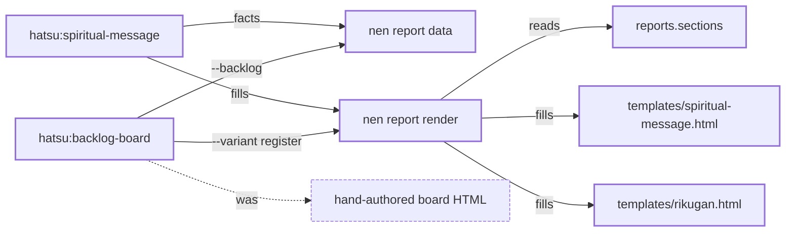

<!--
  rikugan.md -- the desk and the register as Markdown, for a surface whose native report is a
  Markdown artifact (Antigravity). Filled by the same verb, from the SAME register document
  (nen report data with a register desk) and the SAME reports.sections.<variant>.blocks as
  templates/rikugan.html: one document, two renders, so the two cannot disagree on which blocks a
  variant shows. Block for block it mirrors that file, in its order and under its headings; each
  block opens with a block-marker comment and each ask with an ask-marker comment, which the
  report-markdown-guard lane reads. Structure, escaping and the checked examples:
  docs/PROCESS.md, The Markdown report. NOTHING IN THIS COMMENT SPELLS A SUBSTITUTION TAG.
-->
<!-- hatsu:block masthead -->
# Markdown report templates for Antigravity

Hatsu · rikugan · register

HA#215,HA#250,HA#251 · from: futon zheref/hatsu@model/claude · G4 — yours · 2026-10-13 11:00 CEST

<!-- hatsu:block tally -->

| in scope | need you | blockers | ready | in flight |
|---:|---:|---:|---:|---:|
| 3 | 2 | 1 | 1 | 0 |

<!-- hatsu:block desk -->
## Your desk

### G2 · merge — consumer

> [!NOTE]
> **cleared**\
> nothing is owed at G2 | no consumer PR in scope

### G4 · merge — canon

<!-- hatsu:ask -->
**MERGE** · rank 1

#### Merge HA-PR-#250 into main

ready &amp; it unblocks the Antigravity reports

- **A** · Merge it ⭐ recommended\
  the templates ship\
  <code>gh pr merge 250 --repo zheref/hatsu --merge --match-head-commit 0123abc &amp;&amp; git pull</code>
- **B** · Hold it\
  the PR waits | nothing moves\
  <code>none</code>
- **C** · Close it\
  the reports stay &lt;hand-authored&gt;\
  <code>gh pr close 250 --repo zheref/hatsu</code>

Objects: [HA-PR-#250](<https://github.com/zheref/hatsu/pull/250>)

> [!IMPORTANT]
> **Readiness, verbatim:** “ready: 6/6 checks green &amp; 0 unresolved threads &lt;head 0123abc&gt;”

<!-- hatsu:ask -->
**DO** · rank 2

#### Fix the red prose-guard on HA-PR-#251

1 red check &amp; 1 unresolved thread block it

- **A** · Trim the skill and re-run the guard ⭐ recommended\
  the check goes green\
  <code>sh scripts/prose_size_check.sh --headroom</code>
- **B** · Drop the PR\
  the escape fix is lost | re-filed later\
  <code>gh pr close 251 --repo zheref/hatsu</code>

Objects: [HA-PR-#251](<https://github.com/zheref/hatsu/pull/251>)

> [!IMPORTANT]
> **Readiness, verbatim:** “not-ready: 1 red check (prose-guard) | 1 unresolved thread”

<!-- hatsu:block register -->
## The register

One row per issue and pull request in scope. Open a row for its gate, its verdict and what it is waiting on.

HA-PR-#250 · feat(reports): Markdown templates | one data document · ★ ready · G4

- State: OPEN · enhancement, lang/prose
- Verdict: ready: 6/6 checks green &amp; 0 unresolved threads &lt;head 0123abc&gt;
- Checks: 6/6 green · 0 red · 0 pending
- Threads: 0/3 unresolved
- Linked: HA-IS-#215
- Needs: your merge
- Driving: kurapika · lane plugin
- Head: 0123abc0123abc0123abc0123abc0123abc0123a
- Thought: the templates &amp; the guard | one PR
- Link: [https://github.com/zheref/hatsu/pull/250](<https://github.com/zheref/hatsu/pull/250>)

HA-PR-#251 · fix(reports): escape &lt;code&gt; values &amp; the mermaid fence · red · G4

- State: OPEN · bug
- Verdict: not-ready: 1 red check (prose-guard) | 1 unresolved thread
- Checks: 5/6 green · 1 red · 0 pending
- Threads: 1/1 unresolved
- Linked: 
- Needs: a trim
- Driving: kurapika · lane plugin
- Head: 4567def4567def4567def4567def4567def4567d
- Thought: 2 bytes over &lt;ceiling&gt;
- Link: [https://github.com/zheref/hatsu/pull/251](<https://github.com/zheref/hatsu/pull/251>)

HA-IS-#215 · Antigravity reports ignore the spiritual-message and Rikugan templates ·  · G1 — cleared

- State: OPEN · enhancement, lang/prose
- Verdict: 
- Checks: 
- Threads: 
- Linked: HA-PR-#250
- Needs: nothing
- Driving:  · lane 
- Head: 
- Thought: closed by HA-PR-#250 once merged
- Link: [https://github.com/zheref/hatsu/issues/215](<https://github.com/zheref/hatsu/issues/215>)

### The report path: one data document, two templates per report

The same delta as text — nodes and edges

Nodes:

- hatsu:spiritual-message · skill · changed
- hatsu:backlog-board · skill · changed
- nen report data · verb · changed
- nen report render · verb · changed
- reports.sections · config · added
- templates/spiritual-message.html · template · changed
- templates/rikugan.html · template · added
- hand-authored board HTML · residue · removed

Edges:

- spiritual-message → facts → report-data · unchanged
- spiritual-message → fills → report-render · changed
- backlog-board → --backlog → report-data · added
- backlog-board → --variant register → report-render · added
- report-render → reads → sections · added
- report-render → fills → tpl-spiritual-message · unchanged
- report-render → fills → tpl-sm · added
- backlog-board → was → handwritten · removed

<!-- hatsu:block spend -->
## Spend

### ha-215-markdown-report-templates

#### Where the time went

| Phase | Share | Time | Steps |
|---|---:|---:|---|
| rasengan | 100% | 4 m 05 s | render 2.1 s · guard 9.8 s |

#### Tokens by model

| Surface | Model | Input | Output | Cache read | Cache write | Minutes | Source |
|---|---|---:|---:|---:|---:|---:|---|
| claude-code | opus | 120400 | 18200 | 990000 | 41000 | 22 | /cost |
| antigravity | pro | not reported | | | | | |

Actions minutes: 6

Antigravity reports no token counts | not reported

<!-- hatsu:block legend -->
## Legend

- ⭐ — the recommended option on an ask: exactly one per ask, and the same one the surface's own picker stars
- Grouped by gate — the desk is ordered by gate, then by how much each answer unblocks. A gate with nothing owed is shown cleared, never hidden

---

3 objects in scope · 2 asks on the desk

HA#215,HA#250,HA#251 · from: futon zheref/hatsu@model/claude · register · 2026-10-13 11:00 CEST

Verdicts quoted from nen pr ready; a merged object reads merged with its SHA. Verdicts read from objs.json, not from GitHub.
