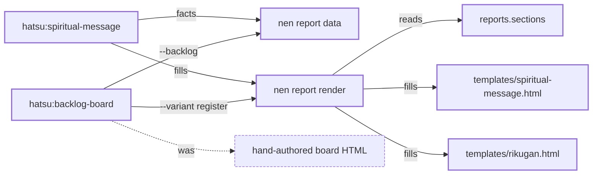

<!--
  spiritual-message.md -- the turn and landing report as Markdown, for a surface whose native report
  is a Markdown artifact (Antigravity). Filled by the same verb, from the SAME data document and the
  SAME reports.sections.<variant>.blocks as templates/spiritual-message.html: one document, two
  renders, so the two cannot disagree on which blocks a variant shows. Block for block it mirrors
  that file, in its order and under its headings; each block opens with a block-marker comment
  the report-markdown-guard lane reads. Structure, escaping and the checked examples:
  docs/PROCESS.md, The Markdown report. NOTHING IN THIS COMMENT SPELLS A SUBSTITUTION TAG.
-->
<!-- hatsu:block masthead -->
# Markdown report templates for Antigravity

Turn 3 · Hatsu · spiritual-message · turn

zheref/hatsu · against origin/main · 2026-10-13 11:00 CEST

stage blocked · G5 — yours · worktree fmc-215 · branch fable/kurapika/ha-215-markdown-report-templates

<!-- hatsu:block tally -->

| need you | blockers | landed | gaps |
|---:|---:|---:|---:|
| 1 | 1 | 4 | 1 |

<!-- hatsu:block desk -->
## Your desk

<!-- hatsu:ask -->
**DO** · G5

### Install nen 0.21.0 so the render can run?

The render refused: nen out of range &amp; no bootstrap on this host

- **A** · Bootstrap the pinned nen ⭐ recommended\
  the render runs on the next turn
  <pre>nen bootstrap --ref v0.21.0 --source zheref/nen --script &quot;$f&quot; &amp;&amp; nen --version</pre>
- **B** · Stop the effort here\
  no report is published | the gap stays named
  <pre>none</pre>
- **C** · Hand the install to the maintainer\
  the loop waits &lt;untimed&gt;
  <pre>echo &#39;run the bootstrap&#39; &gt; /dev/null</pre>

Objects: [HA-IS-#215](<https://github.com/zheref/hatsu/issues/215>)

Why this is a G5 — the evidence

> [!CAUTION]
> D10 · stopped at spiritual-message § 6 · after kokusen
>
> nen report render is a Nen-owned operation &amp; has no improvised fallback
>
> **Next action:** run the bootstrap the contract&#39;s halt.message_template names

- nen --version: command not found
- bootstrap exit 5 | checksum fetch refused

<!-- hatsu:block lastTurn -->
## This last turn

Render the Antigravity artifact from a template | not by hand

The request, in full

<pre>Add templates/spiritual-message.md &amp; templates/rikugan.md;
fill them with nen report render &lt;variant&gt;.</pre>

- landed · Two Markdown templates beside the HTML ones — one data document | two renders
- not delivered · A stdout render for the brain directory — --out must resolve inside --repo; the copy goes through &lt;reports.dir&gt;/current.md

<!-- hatsu:block landed -->
## Landed, fought back, not delivered

The whole session against origin/main, not just this turn.

### Landed

- templates/spiritual-message.md &amp; templates/rikugan.md — the blocks, order and desk rules of the HTML | verbatim

### Fought back

- Escaped values inside code spans — GFM shows &amp;amp; literally there, so commands render in &lt;code&gt;

### Not delivered

- A render to stdout — a nen request | tracked separately

<!-- hatsu:block delta -->
## Architecture delta

The report path: one data document, two templates per report

The same delta as text — nodes and edges

Nodes:

- hatsu:spiritual-message · skill · changed
- hatsu:backlog-board · skill · changed
- nen report data · verb · changed
- nen report render · verb · changed
- reports.sections · config · added
- templates/spiritual-message.html · template · changed
- templates/rikugan.html · template · added
- hand-authored board HTML · residue · removed

Edges:

- spiritual-message → facts → report-data · unchanged
- spiritual-message → fills → report-render · changed
- backlog-board → --backlog → report-data · added
- backlog-board → --variant register → report-render · added
- report-render → reads → sections · added
- report-render → fills → tpl-spiritual-message · unchanged
- report-render → fills → tpl-sm · added
- backlog-board → was → handwritten · removed

<!-- hatsu:block evidence -->
## Evidence

> [!NOTE]
> no snapshot suite is declared for this lane

\
after

### Tests

- passed · report-markdown-guard — every variant renders | blocks in order &amp; one star per ask

### Touched-file coverage

| File | Lines | Band |
|---|---:|---|
| scripts/report_markdown_check.sh | 92% | ideal |

<!-- hatsu:block launch -->
## How to launch

<pre>nen report render --variant turn --template &quot;$hatsu_root/templates/spiritual-message.md&quot; \
  --data &lt;doc&gt; --out Reports/current.md --repo . &amp;&amp; cat Reports/current.md</pre>

<!-- hatsu:block decisions -->
## Decisions already made

- Free text rides in lists, never table cells — a | in a value would split the cell

---

Turn 3 · blocked · G5 — yours · fmc-215 · fable/kurapika/ha-215-markdown-report-templates

zheref/hatsu · against origin/main · turn · 2026-10-13 11:00 CEST

Object notation from nen ref format; verdicts quoted from nen pr ready.
